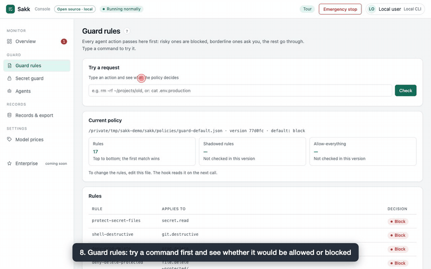

# Sakk

[English](README.md) | **简体中文**

> **最早的那张“支票”，为 AI 智能体重新造一遍。**

Sakk 在编程智能体超支、泄露密钥或 force-push **之前**就把它拦下：一个面向
Claude Code、Cursor 和 Codex 的失败即拒绝（fail-closed）守卫，一个面向
Claude Code 的每日花费上限，一个急停开关，以及一本给你自己的智能体代码用的花费账本。
本地运行，零依赖，Apache-2.0 许可。



```bash
npm install -g sakk && sakk guard install claude-code && sakk doctor   # 在你的项目目录里运行
```

在中世纪阿拉伯商业里，**ṣakk**（صك）是一张书面付款指令——商人以真实资金担保的承诺，在各条商路上都被兑付。这个词经波斯语和拉丁语进入英语，成了 _cheque / check_（支票）。它的复数 _sukuk_ 至今仍是海湾地区金融工具的名字。

英语保留了这个词的两层意思：你开出的 **check**（钱），和你执行的 **check**（核验）。AI 智能体恰好需要这两样东西，并且要焊在一起。这就是 Sakk：

**一本面向 AI 智能体、失败即拒绝的花费账本——没有预留，不准启动；没有证据，不准通过。**

本页回答这些问题：

- [如何阻止 AI 编程智能体执行 force-push 这类危险命令？](#如何阻止-ai-编程智能体执行-force-push-这类危险命令)
- [如何防止 Claude Code 花钱过多？](#如何防止-claude-code-花钱过多)
- [如何防止 AI 智能体泄露密钥？](#如何防止-ai-智能体泄露密钥)
- [如何给自己的智能体代码设硬预算？](#快速上手如何给自己的智能体代码设硬预算)
- [如何停住失控的 AI 智能体？](#急停开关如何停住失控的-ai-智能体)
- [如何在任意智能体前面加一道预算闸门？](#mcp如何在任意智能体前面加一道预算闸门)
- [Sakk 和 ccusage、Claude Code 的 /cost 有什么不同？](#sakk-和-ccusageclaude-code-的-cost-有什么不同)

第一次用？从[教程](docs/tutorial/en.md)（英文）或 [FAQ](docs/FAQ.md) 开始。

## 为什么

智能体花的是真钱，而且自己汇报自己有没有成功。这两点都是问题：

- 凌晨 3 点的重试死循环，看起来和一个正常干活的智能体没有区别——直到账单到来。
- 一个从没跑过测试的智能体说“所有测试通过”，和真的通过看起来一模一样。

账本补上第一个缺口。[`eval/`](eval/) 里的评测框架用机器证据给第二个缺口打分（可携带的证据包在路线图上）。每一个可能花钱的动作，都必须在执行**之前**向一本设了上限的账本**预留**（reserve），执行之后再按真实花费**结算**（settle）。所有异常情况一律拒绝：

| 情况                                 | Sakk 的回答                                                                                                          |
| ------------------------------------ | -------------------------------------------------------------------------------------------------------------------- |
| 预算将达到上限                       | **拒绝。** 上限是一堵墙，不是目标——达到上限就算越过。                                                                |
| 同一个 `callId` 被预留两次           | **拒绝。** 账单去重了、副作用却重新执行，钱就是这样漏掉的。                                                          |
| 账本缺失 / 损坏 / 过期 / schema 不对 | **拒绝。** 坏掉的账本永远不等于“到目前为止零花费”。过期 = 7 天未确认；由一个人用 `sakk reconcile --by <name>` 恢复。 |
| 失败后实际花费无从得知               | **不编数字。** 该条目进入对账状态，一个全局标志会停掉之后所有付费调用，直到一个具名的人把它清除。                    |
| 锁被另一个进程持有                   | **超时后拒绝。** 没有互斥就绝不判断预算。                                                                            |
| 通过符号链接或硬链接访问账本         | **拒绝**（`LEDGER_PATH_NOT_CANONICAL`）。写入会替换那个链接、把账分叉；请使用唯一的真实路径。                        |
| 普通的读取失败                       | **绝不自动创建一本空账本。**“账本丢了就等于钱白给”正是这个工具要堵上的后门。                                         |

两个并发的智能体无法合起来超支：读-改-写在原子锁下执行，写入走临时文件+重命名，而且有一场真实竞争来证明：同时启动的八个进程对同一个上限预留，每一笔获准的预留都必须入账，且没有任何一笔超过上限（`test/ledger.test.mjs`，“8 concurrent processes cannot jointly overspend”；变异演练 MUT-Z 去掉锁后，这场竞争就会变红）。

## 安装

```bash
npm install sakk        # 或者不安装，直接调用 CLI：npx sakk …
```

## 如何阻止 AI 编程智能体执行 force-push 这类危险命令？

```bash
sakk guard install claude-code   # 或：cursor、codex
sakk doctor                      # 检查钩子是否真的会触发
sakk try 'git push --force origin main'   # 看守卫会怎么回答
```

智能体的每一次 Edit、Write 和 shell 调用都会在执行前被判定：
force push、项目外的删除、读取密钥和部署，会按一份你能阅读和修改的策略被拒绝或先询问你。
内容是密钥的写入、或会打印出密钥的命令，同样会被拒绝。守卫按命令字面写出的内容来判断——
见本页末尾的局限说明和 [docs/GUARD.md](docs/GUARD.md)。

也可以把 Sakk 作为**插件**加载进 Claude Code——它打包了同一个钩子，失败即拒绝
（`onFailure: block`），并且能看到每一个工具。这个仓库本身就是一个插件市场，所以在 Claude Code 里：

```text
/plugin marketplace add sakk-dev/sakk
/plugin install sakk@sakk
```

如果只想在一个会话里从 npm 包加载：

```bash
npm install -g sakk
claude --plugin-dir "$(npm root -g)/sakk"
```

没有自动化测试能驱动 Claude Code，所以这两种方式都靠人手动核对
（[docs/V2-BACKLOG.md](docs/V2-BACKLOG.md) 中由所有者手动跑的 P-INS-008）。

在一个本地、只读的控制台里查看守卫做了什么——今天的花费和上限、最近的决策、带试判框的策略，以及密钥拦截记录：

```bash
sakk ui        # 打印 http://127.0.0.1:<port>/?t=… ——只读；Ctrl+C 停止
```

## 如何防止 Claude Code 花钱过多？

给当天的花费设上限（数据读自 Claude Code 的本地日志——是估算，不是账单）。上限由人来设。守卫会拒绝智能体执行 `sakk cap` 命令和写入 `~/.sakk`，一条能绕到那里的单命令符号链接链需要人批准。在终端里，取消上限、调高上限或改变它的计日方式，都要你重新输入一个词来确认；没有终端时，它以 `HUMAN_CONFIRMATION_REQUIRED` 拒绝，什么都不改。放在 shell 变量里的路径目前还拦不住——见本页末尾的局限说明：

```bash
sakk cap set 5 --zone Asia/Dubai   # 今天花费达到 $5 后拒绝付费调用
sakk spend                         # 今天按模型分列的花费
sakk cap off                       # 取消上限（会请你确认）
sakk prices                        # 当前使用的价格表，以及它的来源
```

按 token 计的费率随包附带在 `prices/snapshot.json` 中，由公开的
[LiteLLM 价格表](https://github.com/BerriAI/litellm/blob/main/model_prices_and_context_window.json)
（MIT）重新生成——文件里的 `source` 块记录了它所基于的确切提交和 SHA-256，
`sakk prices` 会打印这份出处。这些是社区数据，是估算，不是任何服务商的账单。
价格表里没有的模型**不去猜**：它的价格记为无，当天的上限随之失败即拒绝（`PRICE_UNKNOWN`），
而不是少算你的花费。要覆盖某个费率或新增模型，在 `~/.sakk/prices.json` 放一份
`sakk-prices.v1` 价格表（用户的表优先于随包附带的表；格式错误的表会被拒绝，绝不会被悄悄忽略）；
维护者通过对 LiteLLM 价格表重新运行 `scripts/prices-trim.mjs` 来刷新随包快照。

## 如何防止 AI 智能体泄露密钥？

两层防线，用的是同一套规则：

- **在智能体的钩子里。** 装好守卫后，内容是密钥的写入、或会打印出密钥的命令，会在执行前被拒绝；
  默认策略也会拒绝读取 `.env` 这类密钥文件。控制台的密钥拦截面板会显示拦下了什么。
- **在 git 里。** `sakk scan` 检查文件和已暂存的提交，`--install-hook` 会拒绝含有密钥的提交。

### 密钥扫描

```bash
npm install --save-dev sakk     # 钩子运行的是这份已安装的副本——不是 npx
npx sakk scan src config        # 扫描路径；发现任何东西就以 1 退出
npx sakk scan --install-hook    # 拒绝含有密钥的提交和合并提交
```

它识别八种格式：带密码的数据库 URL（`postgres`、
`postgresql`、`mysql`、`mariadb`、`mongodb`、`mongodb+srv`、`redis`、`rediss`、
`amqp`、`amqps`、`mssql`、`sqlserver`），任意 URL 中经 URL 编码的密码，
AWS 访问密钥，形如 `sk_live_…`/`sk_test_…`/`rk_live_…`/`rk_test_…` 的 API 密钥，
`sk-`/`sk_`/`rk-`/`rk_` 后接至少 20 个且含数字的字符，或 `sk-` 后接至少 40 个字符
（所以 `sk_set_flags` 不匹配，但以 `sk_` 开头且含数字的长标识符会匹配），GitHub
令牌（经典版和细粒度版），私钥块（PEM 和 PGP），bearer 令牌，以及
带引号的 `password = "…"` 赋值。其他任何形态的密钥它都**不会**发现——比如不带引号的 `.env`
行 `PASSWORD=hunter2hunter2`、其他 URL 协议、一串裸的随机字符串、个人数据。在密钥位置上出现的
引用（`${REDIS_PASSWORD}`、`$PW`、`%(pw)s`、`{{ pw }}`）不会被报告。扫描干净的意思是
“没有这几种格式”，不是“没有密钥”。

发现结果会打印规则、路径、行号和一个 12 字符的带密钥指纹——
绝不打印密钥本身。这个密钥每次运行随机生成；需要跨运行比对指纹时，设置 `SAKK_SCAN_KEY`（并妥善保密）。
文件名本身含有密钥时，会被脱敏打印并计为一条发现；文件名里的控制字符会被转义打印。
唯一的豁免是一个自我声明为假的密钥：它包含
`TEST_ONLY_FAKE_SECRET_DO_NOT_USE`，且旁边没有其他形似密钥的内容；
没有 localhost 例外。

退出码：0 干净，1 有发现，2 扫描没能完成它的工作——路径不存在（`SCAN_PATH_MISSING`），
文件读不了、是 fifo 或设备、或超过 256 MB（`SCAN_UNREADABLE`），不是 git 仓库，
没有 git，钩子已存在或不可写，`--staged` 与路径同时使用
（`SCAN_USAGE`）。你点名的路径总会被扫描（哪怕是 `dist/`，哪怕要穿过符号链接）；在这些路径内部，
`node_modules`、`.git`、`.next`、`dist`、符号链接、二进制文件，以及按名字看像媒体或压缩包的文件（`.png`、
`.jpg`、`.gif`、`.zip`、`.gz`、`.tgz`、`.woff`、`.ico`、`.mp4`、`.bundle`——
按名字判断，不看内容）会被跳过，跳过的数量计入汇总。带字节序标记的 UTF-16 和 UTF-32 文件按文本扫描。

`--staged` 扫描的恰好是这次提交会记录的内容——索引里每一个新增、修改或类型变更的 blob，
无论你在哪个目录运行；已暂存符号链接的目标也算内容（replace 引用会被忽略：
扫描的字节就是提交记录的字节）。`--install-hook` 写入
pre-commit 和 pre-merge-commit 钩子（git 2.24+），按绝对路径运行已安装的
sakk。没有任何 git 钩子能看到快进合并、变基、
cherry-pick 或 `--no-verify`——请在 CI 里也运行 `sakk scan .`。
只要任一钩子已存在（哪怕是悬空符号链接），它就拒绝，并且两个都不装；它也拒绝从临时的 `npx`、
`bunx` 或 `pnpm dlx` 缓存安装（`SCAN_HOOK_EPHEMERAL`）——那份副本在缓存清理后就会消失。
钩子固定了 node 的真实路径：升级 node（Homebrew、nvm）或移动 sakk 之后，提交会以
`SCAN_HOOK_STALE` 被拒绝，直到你重新运行 `--install-hook`。

## 快速上手：如何给自己的智能体代码设硬预算？

```bash
npx sakk init --cap 25          # 创建 ~/.sakk/sakk-ledger.json（拒绝覆盖）并接到守卫上
npx sakk status                 # 总额、条目、对账状态（机器读取用 --json）
npx sakk reconcile --by alice   # 清除对账停机——需要一个名字
npx sakk ledger verify          # 检查封存历史的哈希链（断了就以 1 退出）
```

账本类命令（`init`、`status`、`reconcile`、`halt`、`resume`、
`unlock`、`mcp`、`ledger verify|export`）接受 `--ledger <path>`。不传时，
它们依次使用：`sakk init` 记录在 `~/.sakk/config.json` 里的绝对路径
（守卫钩子读的是同一项），然后是 `SAKK_LEDGER_PATH`
（设了但为空则拒绝），然后是 `~/.sakk/sakk-ledger.json`——位于智能体会写入的
项目目录之外。当前目录里残留的 `./sakk-ledger.json` 会以 `LEDGER_PATH_LEGACY` 拒绝，
直到你传 `--ledger` 或把它移走，这样一次停机永远不会落进一个没人读的文件。
`mcp` 仍然需要这个参数或环境变量。

已结算的条目会被封存进一条只追加、带哈希链的冷账
（`<ledger>.cold/`），这样活跃文件保持很小，一次调用的开销与历史长短无关；
没有封顶，也不会丢任何条目。`sakk ledger verify` 逐条走这条链，`sakk ledger export` 重建一本扁平账本。
同一时刻最多允许 10,000 笔未结算的预留。

当需要一个人先采取行动、花费才能恢复时——需要对账（标志或条目）或账本过期——`sakk status`
以 3 退出；全局停机时以 4 退出；你可以用它来卡住 CI。只要每一笔预留都会被拒绝，
`max_reservable_usd` 就是 0。

在代码中：

```js
import { initLedger, reserve, settle, LedgerError } from 'sakk';

const ledgerPath = './ledger.json';
initLedger({ ledgerPath, capUsd: 25 }); // 显式创建——账本从不会被隐式创建

// 每个付费动作之前。reserve() 拒绝时会抛出 LedgerError
// （e.code 说明原因）——只要它正常返回，钱就已经预留：
try {
  reserve({ ledgerPath, callId: 'task-42:call-1', estimatedMaxUsd: 1.5 });
} catch (e) {
  if (e instanceof LedgerError) return skipThisAction(e.code); // 不要调用模型
  throw e;
}
const result = await callYourModel();
settle({ ledgerPath, callId: 'task-42:call-1', actualUsd: result.costUsd });

// 如果花费无法确定：
settle({ ledgerPath, callId: 'task-42:call-1', failedUnknownCost: true });
// → 账本进入 RECONCILIATION_REQUIRED；之后每一个付费调用都会被拒绝。
// 要恢复，先由一个人用他决定的数字（发票金额，或核销）结算这笔未结条目
// ——只要还有任何条目未结，清除就会被拒绝（RECONCILIATION_ENTRIES_OPEN）：
settle({ ledgerPath, callId: 'task-42:call-1', actualUsd: 0.4 });
clearReconciliation({ ledgerPath, by: 'your-name' });
```

零依赖。纯 Node（≥20），运行在 **macOS 或 Linux** 上（锁和工具链都基于
POSIX；暂不支持 Windows）。账本是一个人类可读的 JSON 文件；告警追加写入它旁边一个可 grep 的
`sakk-alerts.jsonl`（绝不会通过一个被植入的符号链接写入）。写入会先 fsync 再原子重命名。
在 Linux 上这能扛住断电；在 macOS 上 fsync 不会刷新磁盘缓存（Node 没有 F_FULLFSYNC），
所以断电可能丢失最后几次写入。

这个 API 刻意设计为**同步**的（等锁最多阻塞约 3 秒）：适用于 CLI、钩子和每任务一个进程的场景。
在长期运行的异步服务器里，请在 worker 线程中调用。账本是每次调用都整体扫描的单个 JSON 文件
——适合每本账几百到几千条目；超过这个量请归档或轮换（带哈希链的账本模式——企业版，在路线图上——
是为规模设计的路径）。

踩坑换来的实用建议：

- **`estimatedMaxUsd`** = 服务商对这一次调用最多可能收的钱
  （例如最大输出 token × 价格，或服务商自带的预算上限参数）。估高了会占住预算；
  估低了就是不诚实——在结算纠正之前，上限检查都按估算值来算。
- **预留和结算之间崩溃了？** 这笔预留会一直未结，继续占着上限——这是对的，
  因为钱可能真的已经花出去了。在任何进程里用**同一个 `callId`** 结算即可恢复：
  知道数字后用 `settle({ ledgerPath, callId, actualUsd })`，
  无从得知时用 `failedUnknownCost: true`（这会停住账本，等一个人处理）。
  `sakk settle` CLI 命令尚未发布（not shipped），在路线图上；目前补结算是一段三行的 Node 脚本。
- **`markReconciliationRequired`** 用于带外发现——与账本对不上的发票、
  服务商事故。它会停掉之后所有预留，直到一个具名的人清除该标志。

如果一个进程持锁时崩溃，下一个调用者通常能检测到持有者已死（同一主机）并自动破锁。
如果崩溃恰好发生在锁被创建或释放的那几微秒里，会留下一个它无法判断的锁
（实测：100 次 SIGKILL 中约 3 次）；这个锁保持锁定——失败即拒绝——
直到 `npx sakk unlock --by <your-name>`。同一个账本目录不得跨主机共享：判断持有者是否已死要比较主机名。

**审计者**：[docs/AUDITOR_REPLAY.md](docs/AUDITOR_REPLAY.md)——你在自己的一台干净机器上、
30 分钟内、无需信任我们就能核验的内容。

## API

`initLedger · reserve · settle · halt · resume · markReconciliationRequired · clearReconciliation · forceUnlock · readLedger · totalsOf · LedgerError (every refusal carries .code and .details)`

记账规则：`settled actuals + outstanding reservations (at estimated max) + this estimate >= cap ⇒ refuse`。

### `sakk/policy` —— 决策内核

```js
import { loadPolicy, decide, logDecision, PolicyError } from 'sakk/policy';
```

对 _“这个智能体能否以这个花费执行这个动作？”_ 的一个声明式、按哈希固定的回答，
在任何预留产生**之前**做出。`decide()` 是纯函数：相同的策略字节 + 相同的上下文
→ 在任何机器上都得出相同的判决；每一条记录下来的决策都带着产生它的策略文件的 SHA-256
——“3 月 3 日为什么允许了这件事？”靠重放回答，而不是靠信任。策略文件
（`sakk-policy.v1`，纯 JSON）自上而下读取，**先匹配者生效**，
`default_verdict` 是必填的，所有异常情况一律拒绝：
`POLICY_VACUOUS_ALLOW`（只会说“是”的闸门：默认允许下没有任何拒绝规则，
或第一条规则就放行一切），
`POLICY_RULE_SHADOWED`（可证明永远不会命中的规则），`POLICY_SCHEMA_INVALID`（智能体名或动作名里
出现 `*` 也算——只有单独的 `*` 才是通配符），`CONTEXT_INVALID`（不做类型强转——也不接受路径别名：
像 `prod//x` 这样的非规范范围会直接拒绝，而不是从拒绝规则旁边溜过去），
`POLICY_TOO_COMPLEX`（靠拒绝来限界，绝不靠卡死），
`DECISION_UNLOGGABLE`（无法审计的允许就是拒绝）。

依赖一条拒绝规则之前，要知道两个局限：

- **在 `default_verdict: allow` 下，拒绝规则只约束调用方声明了的东西。**
  针对 `scope` 或 `action` 的规则，匹配不到省略了该字段的请求，于是请求落到默认允许上。
  当调用方本身就是被约束的一方时，请用默认拒绝（比如守卫自己的策略
  `policies/guard-default.json`）。
- **路径按字节逐一比较。** 内核和 MCP 执行器
  不折叠大小写、不解析符号链接、不做 Unicode 规范化：在
  大小写不敏感的卷上（macOS 默认），`Prod/api` 在磁盘上就是 `prod/api`，
  对策略来说却不是。请在调用 `decide()` 之前规范化，或使用
  默认拒绝。[`policies/`](policies/) 中附带两份参考策略——一份宽松的开发配置，和守卫的
  默认拒绝配置；面向监管的配置和合规案例包留给企业版（即将推出）。内核从不导入账本，也从不执行
  动作；由执行器把两者组合起来：`decide()` → 仅在 `allow` 时 →
  `reserve()`。

## 急停开关：如何停住失控的 AI 智能体？

```bash
npx sakk halt --by alice --reason "runaway agent"   # 之后每一笔新预留都会被拒绝
npx sakk halt --by alice --agent bot-7              # 只停一个智能体
npx sakk resume --by alice                          # 解除（具名）
```

`sakk init` 把账本的绝对路径记录在 `~/.sakk/config.json` 里，
所以一次停机也会停住装了守卫的智能体：守卫能看到的每一次工具调用（读取仓库除外）都会被拒绝，
直到 `sakk resume`。对 Claude Code，`sakk guard install claude-code` 把 shell 命令、
文件读取与编辑、Monitor 和 MCP 工具交给守卫；Glob、Grep、WebFetch、WebSearch
和子智能体（Task）不经过它。以插件方式加载时，守卫能看到每一个工具。再次运行 `init` 会接上一本已有的账本而不改动它，并且绝不替换
一个已记录的不同路径——它会告诉你钩子仍在读哪本账。
因为它决定了钩子从哪里读取停机状态，守卫会拒绝智能体执行
`sakk init`，就像拒绝 `sakk cap` 一样；由一个人来运行它。

停机期间，`reserve()` 以 `LEDGER_HALTED`（或 `AGENT_HALTED`）拒绝，
每一笔被停机拒绝的预留都会记录到 `sakk-alerts.jsonl`
（更早因其他原因被拒绝的尝试——无效的智能体 id、过期的账本——带着各自的代码，不算停机告警），
`sakk status` 会显示是谁停的，全局停机时以 4 退出——这样 CI 也会停
（按智能体的停机会列出来，以 0 退出：其他智能体可能仍在花钱）。进行中的调用
仍可结算它们的真实花费。停机不能被任何资金操作解除，只能用 `resume`；智能体无法通过 MCP 自己解除。
过期或处于对账中的账本仍然可以被停机。按智能体的停机
精确匹配智能体 id（区分大小写，逐个码位比较——不做
Unicode 规范化，所以用两种方式输入的 `café` 是两个 id），并依赖调用方
在预留时声明的 id——换了 id 的智能体会逃过按智能体的停机；
全局停机才是硬停止。第一次停机会把账本文件升级到 schema `sakk-ledger.v2`，
更早版本的 sakk 拒绝读取它：旧的二进制永远无法绕过一个它看不懂的停止去花钱。

## MCP：如何在任意智能体前面加一道预算闸门？

`sakk mcp` 通过 stdio 说 Model Context Protocol——与库相同的三个
操作，以智能体必须调用的工具的形式提供。Claude Code 的
配置（Cursor/Copilot 同理）：

```json
{
  "mcpServers": {
    "sakk": {
      "command": "npx",
      "args": [
        "sakk",
        "mcp",
        "--ledger",
        "/abs/path/ledger.json",
        "--policy",
        "/abs/path/policy.json"
      ]
    }
  }
}
```

账本路径是**必填**的（没有当前目录默认值——一个靠猜账本放在哪里的服务器算不上闸门）。
`--policy`（或 `SAKK_POLICY_PATH`；设了但为空则拒绝）是可选的；设置之后，每一次
`sakk_reserve` 都先由策略内核判定，每一条决策——
允许和拒绝都一样——都按哈希固定地落进账本旁边的 `<ledger>.decisions.jsonl`。
`require_approval` 在 MCP 上按设计就是拒绝（收集审批是企业版的事，不是智能体工具）。
服务器不增加任何语义：通过库重放同样的调用会得到同样的条目
（callId、状态、金额——时间戳按构造必然不同），测试套件证明了这一点。
策略的 `allow` 是一个决策，不是一笔预留：账本仍可能拒绝它（比如估算为零），
所以要从账本里数预留，而不是从决策日志里数允许。

## Sakk 和 ccusage、Claude Code 的 /cost 有什么不同？

ccusage 告诉你花了多少，Sakk 在花之前拦住你。ccusage 和 Claude Code 的 `/cost`
报告智能体已经花了多少；两者都不会拒绝调用。Sakk 坐在智能体的钩子里，
一旦当天的估算花费达到你的上限，就拒绝下一次工具调用；无论花费多少，它都拒绝 force push 和密钥泄露。
两者可以一起用：报告看钱去了哪，守卫负责拦下。微软的
Agent Governance Toolkit 面向基于它所适配框架构建的智能体，覆盖更宽的治理范围。
有出处、讲公道、也写明 Sakk 做不到什么的完整对比：[docs/compare.md](docs/compare.md)（英文）。

## 文档

- [教程](docs/tutorial/en.md)（英文）——第一次运行，一步一步来
- [FAQ](docs/FAQ.md)
- [与 ccusage、`/cost` 和 Agent Governance Toolkit 的对比](docs/compare.md)
- [智能体守卫](docs/GUARD.md) · [花费与每日上限](docs/SPEND.md) · [架构](docs/ARCHITECTURE.md)
- [审计者重放](docs/AUDITOR_REPLAY.md) · [路线图](docs/ROADMAP.md) · [贡献指南](CONTRIBUTING.md) · [安全](SECURITY.md)

## 路线图（实话版）

更长远的计划，以及每一步取决于什么：[docs/ROADMAP.md](docs/ROADMAP.md)。

- [x] CLI（`sakk init / status / reconcile / unlock / halt / resume / scan / mcp`）
- [x] 评测框架：带变异测试打分的金标用例（裁判也要被裁判）——在仓库的 [`eval/`](eval/) 里，不在 npm 包里
- [x] 策略内核（`sakk/policy`）：声明式的 `sakk-policy.v1`、纯函数 `decide()`、按哈希固定的决策日志
- [x] MCP 服务器执行器（`sakk mcp`）：把 reserve/settle/status 作为工具提供，受策略把关
- [x] 急停开关（`sakk halt / resume`）：具名（自我声明的 `--by`），全局或按智能体；停止状态可从账本证明
- [x] 密钥扫描（`sakk scan`，pre-commit 钩子）：八种手写格式，加上 gitleaks 195 条规则中的 192 条（移植 194 条，启用 192 条），只输出指纹
- [x] 钩子里的密钥守卫：内容是密钥的写入、或会打印出密钥的命令，会被拒绝（开源 v1 M3；与 `sakk scan` 规则相同）
- [x] 由钩子根据本地对话记录执行的每日花费上限，是估算不是账单（开源 v1 M2）；用 `sakk cap set` 设置
- [x] 本地只读控制台 `sakk ui`：花费、决策、策略、密钥拦截（开源 v1 M4）
- [x] 以 Claude Code 插件形式发布（`.claude-plugin/`）（开源 v1 M5）
- [x] `sakk cap set/off`、`sakk spend`、`sakk prices`——设置上限、查看当天花费、显示价格表（F-161）
- [ ] 按法规划分的案例包（CBUAE、DORA、DIFC——按主题，条款编号未核实），逐项要求给出判决——企业版（已移出开源核心）
- [ ] `sakk settle` CLI 命令（不写代码也能补结算）
- [x] 证据包：每次运行一个 .tgz，带清单和它自己的零依赖校验器——审计者无需仓库即可核验（[docs/AUDITOR_REPLAY.md](docs/AUDITOR_REPLAY.md) §6）；从仓库构建，不在 npm 包里
- [ ] 带哈希链（篡改可察觉）的账本模式——企业版
- [ ] 具名审批人身份、SSO——企业版
- [ ] 团队控制台：审批、角色、审计导出、出站计量——企业版（上面的本地只读 `sakk ui` 是开源版）
- [x] README 演示：顶部一行安装命令，以及一张拒绝操作的 GIF
- [ ] 有出处的数字：本 README 中每个准确率数字都有一份链接的测量来支撑——不在本版本（v2）
- [ ] 打包时清扫：对打包文件做一次杂散文件检查加一次密钥扫描——不在本版本（v2）
- [ ] 在低于 20 的 Node 上启动时给出清楚的拒绝，而不是一条原始语法错误——不在本版本（v2）

不在计划内：编排框架、模型层安全（提示词注入检测）。Sakk 是变更管控和证据层，不是又一个智能体平台。

依赖之前，先了解开源核心的这些局限：

守卫和上限：

- **它按命令字面读取。** 运行时拼出来的命令——`eval`、
  反引号、`bash -c "$X"`、`python -c`、`source`——只能被询问或
  拒绝，永远无法按它实际做什么来判断。命令里任何位置出现变量或花括号展开都算：放在其中的读、写、删除或参数——
  `cat .e{nv,x}`、`f=.env; cat $f`、`f=~/.sakk/config.json; rm $f`、
  `o=--force; git push $o`——会被询问，绝不会被直接允许。由 shell 或
  程序在运行时根据字面文本挑出的文件，仍按命令里写的名字来判断，所以用通配符写的 `.env` 读取（`cat .e*`）、
  `grep -r`、`find … -exec cat` 或 `xargs` 会被允许。智能体运行的脚本
  算作一次 `shell.run` 调用。
  只有隔离（容器）才能回答一个命令到底做了什么。
- **`@` 引用会绕过钩子。** 你在 Claude Code 里 @ 提到的文件不经过工具调用就被读取，
  所以守卫看不到它们。
- **上限停住的是下一次调用，而不是越线的那一次。** 已经在进行中的回复会完成，
  所以一个正在运行的智能体可能多出一次回复的花费。
- **日志是智能体能碰到的本地文件。** 上限读取 Claude Code 的
  对话记录；直接写入它们需要人批准，写入
  `~/.sakk` 会被拒绝，但智能体运行的脚本不受检查，可以
  改写它们。已经计入的花费永远不会减少；尚未计入的花费
  可以被抹掉。篡改可察觉的账本属于企业版。上限还通过智能体自己的环境
  （`CLAUDE_CONFIG_DIR`、`HOME`）找到日志，所以
  一个把其中任一项指向空文件夹运行的智能体会读到 $0 花费。
- **旧版 Claude Code 失败即放行。** 在 2.1.295 之前，超时或
  被杀掉的钩子会让调用继续执行。`sakk guard install` 会说明这一点，`sakk doctor`
  会警告。
- **确认检查的是终端，不是人。** 一个 shell 运行在伪终端里的智能体，
  或者它写的、会打开伪终端的脚本，可以输入那个词。守卫在 `script`、`expect` 和 `unbuffer` 之前会询问，
  并且只认得名为 `sakk` 的 Sakk：`npx sakk cap off` 会遇到
  确认，但遇不到守卫的拒绝。具名审批属于企业版。

账本和库：

- **名字是自我声明的。** halt、resume、reconcile 和 unlock 上的 `--by`
  记录的是操作者输入的名字；没有任何东西对它做身份验证。
- **账本的汇总是被信任的。** 守卫会拒绝受守卫的智能体执行
  `resume`、`reconcile` 和 `unlock`——每一个都要在终端前询问一个人——
  默认账本（`~/.sakk/sakk-ledger.json`）也位于
  项目目录之外，但不是受守卫智能体的其他进程仍然可以直接编辑这个
  文件。预留上限信任账本的汇总：
  在那里调低已结算总额就会把上限空间还回来，只有
  `sakk ledger verify` 会报告这一改动。
- **花费是调用方报告的。** `reserve()` 和 `settle()` 按给它们的
  金额记账；目前还没有任何东西读取服务商的用量。
- **需要审批就等于拒绝。** 要求审批的策略
  回答 `POLICY_APPROVAL_REQUIRED`；开源核心没有审批服务。
- **把关是自愿的。** 从不调用 MCP 工具或
  库的智能体不受把关。

同样在 v1 中仍未解决、由 2026-10-28 验收运行发现并推迟到 v2 的：

守卫只按一种拼写比较名字。在大小写不敏感的磁盘上（
macOS 默认），用另一种大小写写出的命令或受保护文件夹会被允许，
git force 参数除两种常见写法之外的其他拼写也会被允许。符号链接按它自己的名字判断，所以一个名字普通、
指向密钥文件的链接可以被读取。`sakk guard install` 不会
把 Claude Code 的搜索工具（Grep、Glob）路由到钩子，也不添加
拒绝读取规则，所以一次搜索可以读到密钥文件；插件的钩子能看到
每一个工具。内容不是文本的 Write 不会被扫描。写入
智能体自己的设置会询问一个人，而不是被拒绝。装在
项目的 `node_modules` 里时，钩子的代码和默认策略是智能体可能改动的项目
文件，所以请全局安装。`sakk init` 会打印“hook
wired”，但并不安装守卫：在它之后运行 `sakk guard install`。

控制台（`sakk ui`）只在命令文本里遮蔽密钥，不在
决策的路径或范围里遮蔽，屏幕上和导出中都是如此。它的试判框会刷新
磁盘上的花费缓存。它的停止按钮在 v1 中不可用，因为
页面读不到自己的会话令牌：请在终端用 `sakk halt`。
（从本版本起，每个响应都带 `Cache-Control: no-store`，并且
每个路由都会拒绝跨站 Origin，不只是停止按钮——F-195。）

[docs/GUARD.md](docs/GUARD.md) 的 “Known open in v1” 一节有详细说明，
[docs/V2-BACKLOG.md](docs/V2-BACKLOG.md) 列出了每一个已知缺口及其计划中的修复。

## 许可证

Apache-2.0——见 [LICENSE](LICENSE)。随包附带的第三方声明在
[NOTICE](NOTICE)。贡献按开发者原创证书（Developer Certificate of Origin，DCO）接受：
用 `git commit -s` 给每个提交加上 sign-off 行，不需要签 CLA——见
[CONTRIBUTING.md](CONTRIBUTING.md)。

企业版——团队控制台、SSO、具名审批人、带哈希链的账本：即将推出（即上面未勾选的路线图条目）。

---

_Sakk（صك）：一张书面承诺，证明钱真的在那里。现在，让你的智能体做出同样的承诺。_
